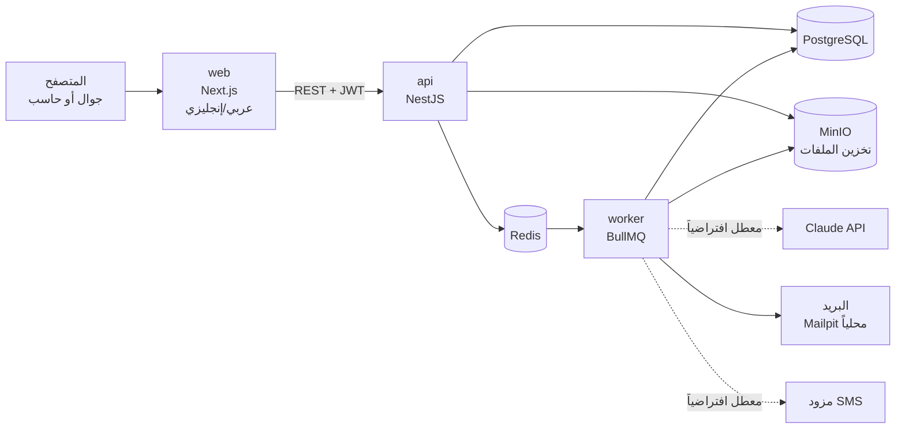

# المعمارية التقنية: منصة ربط الكفاءات المهنية

**المالك:** وكيل المعماري التقني · **الحالة:** مسودة المرحلة 1، بانتظار اعتماد صاحب المشروع

المنصة تطبيق ويب واحد مقسّم إلى وحدات مستقلة (Modular Monolith): واجهة Next.js، وخادم NestJS، وقاعدة PostgreSQL، وكلها تعمل على جهاز واحد بأمر `docker compose up`. هذا الشكل أبسط للتشغيل المحلي والعرض، وينتقل كما هو إلى أي مزود استضافة لاحقاً.

## 1. المكونات



| المكون | التقنية | الدور |
| --- | --- | --- |
| web | Next.js (App Router) + TypeScript + Tailwind + next-intl | الواجهات للأدوار الثلاثة، RTL و LTR |
| api | NestJS + Prisma | منطق الأعمال، الصلاحيات، التدقيق، الواجهات البرمجية |
| worker | نفس شيفرة api، بعملية منفصلة + BullMQ | تحليل السير، إرسال البريد، حساب المطابقة |
| PostgreSQL 16 | قاعدة البيانات | كل البيانات وسجل التدقيق |
| Redis 7 | طابور المهام والجلسات المؤقتة | |
| MinIO | تخزين متوافق مع S3 | السير الذاتية، خاصة وبروابط مؤقتة |
| Mailpit | خادم بريد محلي للتجربة | يعرض رسائل التوثيق دون إرسال فعلي |

## 2. هيكل المستودع

```
apps/
  web/            واجهة Next.js
  api/            خادم NestJS + Prisma + worker
packages/
  shared/         أنواع TypeScript وقوائم ثابتة مشتركة
docs/             المتطلبات، المعمارية، قاعدة البيانات، التصميم، الاختبار
e2e/              اختبارات Playwright
docker-compose.yml
.claude/agents/   تعريفات الوكلاء الخمسة
```

## 3. الوحدات

النواة (core) مشتركة بين كل الخدمات الحالية والمستقبلية. وحدة التوظيف (employment) تبني فوقها. الخدمات الاجتماعية لاحقاً وحدات جديدة بجوار التوظيف.

| الوحدة | الطبقة | تشمل | المتطلبات |
| --- | --- | --- | --- |
| auth | النواة | التسجيل، التحقق بالبريد (رمز لمرة واحدة)، الدخول، استعادة كلمة المرور، JWT | FR-2.1.1، FR-2.2.1 |
| users & roles | النواة | الحسابات، الأدوار، الصلاحيات الدقيقة | FR-2.4.1 |
| people | النواة | الشخص: الاسم الرباعي، الهوية، الجنس، الميلاد، الجنسية، الاحتياجات الخاصة، الدار، الفخذ، التواصل | FR-2.1.2 إلى FR-2.1.5 |
| lookups | النواة | الديار، الأفخاذ، القطاعات، المستويات التعليمية، الدول، بالعربية والإنجليزية | FR-2.1.3، FR-2.1.4 |
| audit | النواة | تسجيل تلقائي لكل تغيير، وشاشة بحث للمدير | FR-2.4.2 |
| notifications | النواة | البريد (مفعّل)، SMS (معطل بمفتاح إعداد) | FR-2.1.1 |
| files | النواة | رفع الملفات وتخزينها وروابط مؤقتة | FR-2.1.9 |
| seekers | التوظيف | التعليم، الخبرات، السيرة، اكتمال الملف | FR-2.1.6 إلى FR-2.1.9 |
| cv-analysis | التوظيف | تحليل السيرة بـ Claude (معطل حتى يضاف المفتاح) | FR-2.1.9 |
| employers | التوظيف | ملف صاحب العمل، اعتماد المدير | FR-2.2.1، FR-2.2.2 |
| jobs | التوظيف | الفرص، الحالة، المطابقة، طلبات الاهتمام، نتيجة الاستقطاب | FR-2.3.1 إلى FR-2.3.5 |
| reports | التوظيف | إحصائيات مجمّعة بلا بيانات شخصية | FR-2.5.1 إلى FR-2.5.3 |
| exports | النواة | تصدير أي تقرير أو قائمة إلى Excel (مكتبة exceljs)، بنفس الفلاتر المعروضة، وبصلاحيات القارئ نفسها | FR-2.5.4 |

## 4. الأدوار ومصفوفة الصلاحيات

| البيانات | الباحث | صاحب العمل | المدير |
| --- | --- | --- | --- |
| ملف الباحث (كامل) | ملفه فقط، قراءة وتعديل | فقط لمن رفع طلب اهتمام على فرصه | قراءة وتعديل |
| سيرة الباحث | سيرته فقط | فقط لمن رفع طلب اهتمام على فرصه | قراءة |
| بيانات صاحب العمل (الاسم، المؤسسة، التواصل) | **لا، أبداً** | ملفه فقط | قراءة وتعديل واعتماد |
| الفرصة (العنوان، القطاع، المدينة، المتطلبات) | قراءة إن كانت متاحة | فرصه فقط، إنشاء وتعديل | قراءة وتعديل |
| طلبات الاهتمام | طلباته فقط | الطلبات على فرصه | قراءة |
| القوائم (الديار، الأفخاذ، القطاعات) | قراءة | قراءة | إدارة كاملة |
| سجل التدقيق | لا | لا | قراءة فقط (لا أحد يعدّل) |
| التقارير | لا | تقارير مجمّعة عامة وتقارير فرصه | كل التقارير |
| تصدير Excel | لا | تقاريره والمهتمون بفرصه فقط | كل التقارير والقوائم وسجل التدقيق |

**كيف يُفرض الإخفاء:** استجابة الفرصة للباحث تُبنى من نوع بيانات (DTO) لا يحتوي أي حقل من جدول صاحب العمل أصلاً، فلا يمكن تسريبه بالخطأ من الواجهة. ويضيف وكيل الجودة اختباراً آلياً يفحص كل استجابة يراها الباحث بحثاً عن اسم المؤسسة.

## 5. التدفقات الأساسية

### تسجيل الباحث
1. يدخل البريد وكلمة المرور ← يُرسل رمز تحقق للبريد ← يؤكد الرمز فيُفعَّل الحساب.
2. يكمل الملف على خطوات: شخصي ← الدار والفخذ ← التواصل ← التعليم ← الخبرات ← السيرة. يُحفظ كل خطوة، ويمكنه العودة لاحقاً.
3. عند رفع السيرة تُضاف مهمة تحليل للطابور. إن كان التحليل معطلاً تُحفظ السيرة فقط.

### الفرصة وطلب الاهتمام
1. يسجّل صاحب العمل ويؤكد بريده ← حالة الحساب "بانتظار الاعتماد".
2. يعتمده المدير ← يستطيع نشر الفرص.
3. الباحث يرى الفرص المتاحة مرتبة بدرجة الملاءمة، مع شارة "مناسبة" أو "مقاربة".
4. يرفع الباحث طلب اهتمام ← يصل صاحب العمل إشعار بالبريد، ويرى ملف الباحث وسيرته وبيانات تواصله.
5. يغلق صاحب العمل الفرصة بإحدى نتيجتين: "تم التوظيف عبر المنصة" (مع اختيار الباحث) أو "أغلقت دون توظيف". تصبح "غير متوفرة" ولا تقبل طلبات جديدة.

## 6. المطابقة

درجة من 0 إلى 100 لكل زوج (باحث، فرصة)، تُحسب في الخادم:

| العامل | الوزن |
| --- | --- |
| تطابق القطاع (قطاع الفرصة مع القطاع المقترح من تحليل السيرة أو قطاعات خبراته) | 40 |
| المستوى التعليمي يساوي المطلوب أو أعلى | 25 |
| سنوات الخبرة تساوي المطلوب أو أكثر | 25 |
| تطابق التخصص أو المسمى الوظيفي بالكلمات | 10 |

70 فما فوق "مناسبة"، ومن 45 إلى 69 "مقاربة". الأوزان والحدود قابلة للتعديل من إعدادات المدير. عند تعطيل تحليل السيرة تعمل المطابقة على البيانات المدخلة وحدها.

## 7. تحليل السيرة الذاتية

- يقرأ worker الملف (PDF أو Word)، ويرسله إلى Claude API مع تعليمات ثابتة، ويطلب مخرجاً منظماً (structured output): القطاع المقترح، المهارات، سنوات الخبرة المستنتجة، 3 إلى 5 نصائح تطوير، باللغتين.
- النتيجة تُحفظ في جدول `cv_analyses` ويستطيع الباحث تصحيح القطاع المقترح.
- يُفعّل بمتغيرين: `CV_ANALYSIS_ENABLED=true` و `ANTHROPIC_API_KEY`. النموذج في متغير `CV_ANALYSIS_MODEL` (القرار معلّق لدى صاحب المشروع).
- يُرسل للنموذج نص السيرة فقط، دون رقم الهوية أو بيانات الدار والفخذ.

## 8. الأمان والخصوصية

| الموضوع | القرار |
| --- | --- |
| كلمات المرور | Argon2id |
| الجلسات | JWT قصير العمر (15 دقيقة) + رمز تحديث في كوكي HttpOnly |
| رقم الهوية/الجواز | تشفير AES-256-GCM في التطبيق، وبصمة HMAC لمنع التكرار |
| الملفات | تخزين خاص، روابط موقعة لمدة 5 دقائق، فحص النوع والحجم (10MB كحد أقصى) |
| سجل التدقيق | جدول إضافة فقط، يُمنع التعديل والحذف عليه بصلاحيات قاعدة البيانات |
| الحذف | حذف ناعم، والمدير وحده يستطيع الحذف النهائي ويُسجّل ذلك |
| حماية الطلبات | تحديد معدل الطلبات لتسجيل الدخول والتحقق، التحقق من كل مدخل في الخادم |
| الموافقة | الباحث يوافق صراحةً عند التسجيل على مشاركة بياناته مع أصحاب العمل عند طلب الاهتمام |
| التقارير | لا تُعرض فئة عددها أقل من 5 أشخاص |
| التصدير | يمر بنفس فحص الصلاحيات، يُسجّل في سجل التدقيق (من صدّر ماذا ومتى وبأي فلاتر)، رقم الهوية مخفي، والملف يُولّد عند الطلب ولا يُخزّن |

## 9. سجل التدقيق

كل عملية كتابة عبر Prisma تمر بطبقة وسيطة (Prisma extension) تسجّل: المستخدم، الدور، العملية، الجدول، معرّف السجل، القيم قبل وبعد (مع إخفاء الحقول المشفرة)، الوقت، عنوان IP. تسجيل الدخول والخروج ومحاولات الدخول الفاشلة تُسجّل أيضاً.

## 10. اللغتان

- العربية افتراضية، والإنجليزية بزر تبديل، والمسار يحمل اللغة (`/ar/...` و `/en/...`).
- القوائم المرجعية تخزن الاسمين `nameAr` و `nameEn`.
- رسائل البريد بلغة المستخدم المختارة.

## 11. التشغيل المحلي

- المتطلب الوحيد على الجهاز: Docker Desktop.
- `docker compose up` يشغّل كل المكونات، وينشئ قاعدة البيانات ويملؤها ببيانات تجريبية وحساب مدير.
- الموقع على `http://localhost:3000`، وصندوق البريد التجريبي على `http://localhost:8025`.
- للعرض على أشخاص آخرين: على نفس الشبكة عبر عنوان الجهاز، أو برابط مؤقت (مثل Cloudflare Tunnel). التفاصيل في `README.md`.

## 12. مصفوفة التتبع

| المتطلب | الوحدة | يختبر في |
| --- | --- | --- |
| FR-2.1.1 | auth | e2e/seeker-registration |
| FR-2.1.2 إلى FR-2.1.5 | people, lookups | e2e/seeker-registration |
| FR-2.1.6 إلى FR-2.1.8 | seekers | e2e/seeker-profile |
| FR-2.1.9 | files, cv-analysis | e2e/seeker-profile، api unit |
| FR-2.2.1، FR-2.2.2 | employers | e2e/employer-onboarding، e2e/privacy |
| FR-2.3.1 | jobs | e2e/privacy |
| FR-2.3.2 | jobs (matching) | api unit، e2e/jobs |
| FR-2.3.3 إلى FR-2.3.5 | jobs | e2e/jobs |
| FR-2.4.1 | users & roles, lookups | e2e/admin |
| FR-2.4.2 | audit | api unit، e2e/admin |
| FR-2.5.1 إلى FR-2.5.3 | reports | api unit، e2e/reports |
| FR-2.5.4 | exports | api unit، e2e/reports |
| FR-2.6.1 | فصل النواة عن التوظيف | مراجعة معمارية |
| NFR-1 | كل ما في القسمين 4 و 8 | e2e/privacy |
| NFR-2، NFR-3 | web | e2e على مقاس جوال وحاسب، باللغتين |

## 13. القرارات المعلّقة
- نموذج تحليل السير (Opus 5.5 مقترح). لا يؤثر على البناء، فهو متغير إعداد.
