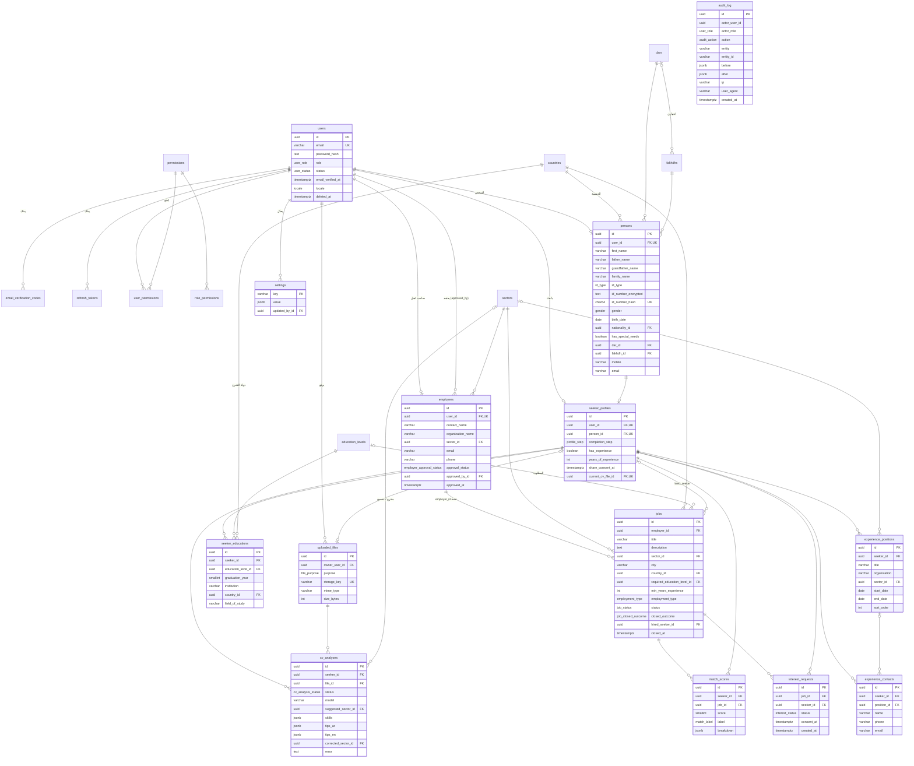

# تصميم قاعدة البيانات: منصة ربط الكفاءات المهنية

**المالك:** وكيل مصمم قاعدة البيانات · **الحالة:** مسودة المرحلة 3، بانتظار المراجعة
**المحرك:** PostgreSQL 16 عبر Prisma 6 · **الملفات:**

| الملف | المحتوى |
| --- | --- |
| `apps/api/prisma/schema.prisma` | النماذج والعلاقات والفهارس والقيود الفريدة |
| `apps/api/prisma/migrations/0001_init/migration.sql` | SQL المولّد من Prisma، ثم قسم مكتوب يدوياً: قيود CHECK، حماية `audit_log`، عروض التقارير |
| `apps/api/prisma/migrations/migration_lock.toml` | `provider = "postgresql"` |
| `apps/api/prisma/seed.ts` | الصلاحيات، القطاعات، المستويات التعليمية، الدول، ديار وأفخاذ تجريبية، الإعدادات، حساب المدير |

## 1. الاصطلاحات

- **المعرّفات:** `uuid` في كل الجداول (تُولّد في التطبيق عبر Prisma).
- **الأسماء:** النماذج بـ PascalCase في Prisma، والجداول والأعمدة snake_case في القاعدة (`@@map` و `@map`).
- **الأوقات:** `timestamptz(3)` بتوقيت UTC، و`date` لتاريخ الميلاد وتواريخ المناصب.
- **`created_at` و `updated_at`** في كل جدول قابل للتعديل.
- **الحذف الناعم:** عمود `deleted_at` (انظر §5).
- **العمر لا يُخزّن:** يحسب من `persons.birth_date` في التطبيق وفي عروض التقارير.
- **البريد:** يُخزّن بأحرف صغيرة، ويفرض ذلك قيد `users_email_lowercase_chk`.
- **القيود التي لا يعبّر عنها Prisma** (CHECK، Triggers، Views) في القسم اليدوي من الترحيل. أداة `prisma migrate diff` تتجاهلها، فلا تحذفها الترحيلات المولّدة لاحقاً. تم التحقق أن `migrate diff --from-migrations ... --to-schema-datamodel ...` يعطي "No difference detected".

## 2. مخطط الكيانات (ERD)

الجداول المرجعية `dars` و `fakhdhs` و `sectors` و `education_levels` و `countries` تشترك في الأعمدة: `id`، `code` (فريد)، `name_ar`، `name_en`، `sort_order`، `is_active`، والأوقات و`deleted_at`. تزيد `education_levels` بعمود `rank`، و`countries` بعمود `iso_code` بدل `code`، و`fakhdhs` بعمود `dar_id`. جداول الصلاحيات `permissions` و `role_permissions` و `user_permissions` مشروحة في §3.1.

## 3. الجداول

### 3.1 النواة: الحسابات والصلاحيات

**`users`** — حساب الدخول لكل الأدوار. البريد فريد، كلمة المرور Argon2id في `password_hash`، الدور `SEEKER | EMPLOYER | ADMIN | SUPER_ADMIN`، الحالة `PENDING_VERIFICATION | ACTIVE | SUSPENDED | DISABLED`، و`email_verified_at` يثبت التوثيق، و`locale` لغة رسائل البريد. `failed_login_count` و `locked_until` لتحديد محاولات الدخول. **يغطي:** FR-2.1.1، FR-2.2.1، FR-2.4.1، NFR-3.

**`email_verification_codes`** — رموز لمرة واحدة للتوثيق واستعادة كلمة المرور (`purpose`). يُخزّن `code_hash` لا الرمز، مع `expires_at` و`attempts` و`max_attempts` (5 افتراضياً) و`consumed_at`. **يغطي:** FR-2.1.1، قرار "التوثيق بالبريد".

**`refresh_tokens`** — جلسات رمز التحديث (الكوكي HttpOnly). يُخزّن `token_hash` فقط. التدوير: كل رمز جديد يُربط بسابقه عبر `replaced_by_id`، وكلها تحمل نفس `family_id`؛ إن استُخدم رمز ملغى تُلغى العائلة كاملة. **يغطي:** المعمارية §8 (الجلسات).

**`permissions`، `role_permissions`، `user_permissions`** — صلاحيات دقيقة بأكواد مثل `employers.approve` و`lookups.manage` و`audit.read`. `role_permissions` الصلاحيات الافتراضية لكل دور، و`user_permissions` منح (`granted=true`) أو سحب (`granted=false`) لمستخدم بعينه. البذرة تملأ 22 صلاحية. **يغطي:** FR-2.4.1.

### 3.2 النواة: القوائم المرجعية

كل قائمة يديرها المدير، بالعربية والإنجليزية، مع `sort_order` للترتيب في القوائم المنسدلة و`is_active` لإخفاء عنصر من الاختيارات الجديدة دون كسر السجلات القديمة. `code` مفتاح ثابت تستخدمه البذرة والتقارير.

| الجدول | الغرض | يغطي |
| --- | --- | --- |
| `dars` | الديار | FR-2.1.3 |
| `fakhdhs` | الأفخاذ. **`dar_id` اختياري**: المتطلبات تذكر قائمتين منسدلتين مستقلتين ولا تذكر علاقة بينهما. الربط الاختياري يسمح للواجهة بتصفية الأفخاذ حسب الدار المختارة متى أدخله المدير، ويبقى الفخذ صالحاً بلا دار إن لم تكن العلاقة هرمية. | FR-2.1.4 |
| `sectors` | القطاعات (صاحب العمل، الفرصة، المنصب، تحليل السيرة) | FR-2.1.9، FR-2.2.1، FR-2.3.2، FR-2.5.2 |
| `education_levels` | المستويات التعليمية. `rank` فريد ويحدد الترتيب لشرط "يساوي المطلوب أو أعلى" في المطابقة | FR-2.1.6، FR-2.3.2، FR-2.5.1 |
| `countries` | الدول (`iso_code` بصيغة ISO 3166-1 alpha-2): الجنسية، دولة التخرج، دولة الفرصة | FR-2.1.2، FR-2.1.6 |

### 3.3 النواة: الشخص

**`persons`** — بيانات الشخص الأساسية، في النواة لا في وحدة التوظيف، كي تعيد الخدمات الاجتماعية المستقبلية استخدامها (FR-2.6.1). `user_id` اختياري وفريد: شخص له حساب واحد على الأكثر، ويمكن مستقبلاً تسجيل شخص بلا حساب (يتيم مثلاً).

- الاسم الرباعي في أربعة أعمدة: `first_name`، `father_name`، `grandfather_name`، `family_name`.
- الهوية: `id_type` (`NATIONAL_ID | PASSPORT`)، `id_number_encrypted`، `id_number_hash` (فريد)، `id_number_key_version` (انظر §4).
- `gender`، `birth_date`، `nationality_id`، `has_special_needs`، `dar_id`، `fakhdh_id`، `mobile`، `email`.
- `mobile` و`email` و`dar_id` و`fakhdh_id` تقبل NULL في القاعدة لأن الملف يُحفظ خطوة بخطوة (المعمارية §5). إلزاميتها تُفرض في التطبيق عند إكمال الخطوة المقابلة، وعند الانتقال إلى `COMPLETED`.
- `email` هنا بريد التواصل (FR-2.1.5) وقد يختلف عن بريد الدخول `users.email`؛ يملؤه التطبيق افتراضياً ببريد الدخول.

**يغطي:** FR-2.1.2 إلى FR-2.1.5، NFR-1.

### 3.4 التوظيف: الباحث

**`seeker_profiles`** — ملف الباحث، واحد لكل مستخدم. `completion_step` يحفظ آخر خطوة (`PERSONAL → TRIBE → CONTACT → EDUCATION → EXPERIENCE → CV → COMPLETED`) ليعود إليها. `has_experience` و`years_of_experience` (FR-2.1.7، FR-2.1.8)، مع قيد يمنع تسجيل سنوات إن كانت الإجابة "لا". `share_consent_at` وقت الموافقة الصريحة على المشاركة (المعمارية §8). `current_cv_file_id` السيرة الحالية. **يغطي:** FR-2.1.1، FR-2.1.7، FR-2.1.8، FR-2.1.9.

**`seeker_educations`** — المؤهلات: `education_level_id`، `graduation_year`، `institution`، `country_id`، و`field_of_study` اختياري (يفيد عامل الكلمات في المطابقة). يُسمح بأكثر من مؤهل، والأعلى `rank` يُعتمد في المطابقة والتقارير. **يغطي:** FR-2.1.6.

**`experience_positions`** — المناصب السابقة بلا حد لعددها: `title`، `organization` اختياري، `sector_id` اختياري (يغذي عامل القطاع في المطابقة)، `start_date`، `end_date` (NULL = حتى الآن، وقيد يمنع أن يسبق البداية)، `sort_order` (منصب 1، منصب 2...). **يغطي:** FR-2.1.8.

**`experience_contacts`** — "معرّف للتواصل والتحقق من الخبرة": شخص مرجعي (`name`، `job_title`، `organization`، `phone`، `email`، `notes`)، مرتبط بالباحث، واختيارياً بمنصب بعينه (`position_id`). **يغطي:** FR-2.1.8.

**`uploaded_files`** — كل ملف في MinIO: `owner_user_id`، `purpose` (`CV | OTHER`)، `bucket`، `storage_key` (فريد)، `original_name`، `mime_type`، `size_bytes` (قيد: 1 بايت إلى 10MB)، `sha256`. لا يُخزّن رابط عام؛ الروابط الموقعة تُنشأ عند الطلب. **يغطي:** FR-2.1.9.

**`cv_analyses`** — كل محاولة تحليل للسيرة: `status` (`PENDING | PROCESSING | COMPLETED | FAILED | SKIPPED`؛ `SKIPPED` حين يكون التحليل معطلاً)، `model`، `suggested_sector_id`، `skills` (JSON مصفوفة)، `inferred_years`، `tips_ar` و `tips_en` (JSON مصفوفة من 3 إلى 5 نصائح)، `corrected_sector_id` و`corrected_at` لتصحيح الباحث، `error`، وعدّادات التوكنز. **يغطي:** FR-2.1.9، المعمارية §7.

### 3.5 التوظيف: صاحب العمل

**`employers`** — جدول مستقل تماماً عن الفرص (القاعدة 2): `contact_name`، `organization_name`، `sector_id`، `email`، `phone`، و`approval_status` (`PENDING | APPROVED | REJECTED | SUSPENDED`)، `approved_by_id` (المدير)، `approved_at`، `rejection_reason`. قيد: الحالة `APPROVED` تتطلب `approved_at`. الوصول إليه للمدراء ولصاحب الحساب فقط، ولا يُضمّن في أي DTO يراه الباحث. **يغطي:** FR-2.2.1، FR-2.2.2، NFR-1، قرار "المدير يعتمد صاحب العمل".

### 3.6 التوظيف: الفرص وطلبات الاهتمام والمطابقة

**`jobs`** — الفرصة، ولا تحمل من صاحب العمل إلا `employer_id`: `title`، `description`، `sector_id`، `city`، `country_id`، `required_education_level_id`، `min_years_experience`، `employment_type`، `status` (`OPEN | UNAVAILABLE`)، `closed_outcome` (`HIRED_VIA_PLATFORM | CLOSED_WITHOUT_HIRING`)، `hired_seeker_id`، `closed_at`، `published_at`. قيود CHECK:
- `OPEN` ⇒ لا نتيجة ولا وقت إغلاق ولا باحث معيّن.
- `UNAVAILABLE` ⇒ النتيجة ووقت الإغلاق إلزاميان.
- `hired_seeker_id` مسموح فقط مع `HIRED_VIA_PLATFORM`. (إلزامية اختيار الباحث عند هذه النتيجة تُفرض في التطبيق، كي لا يمنع الحذف النهائي لباحث إغلاقَ السجل.)

**يغطي:** FR-2.3.1، FR-2.3.4، FR-2.3.5، FR-2.5.2.

**`interest_requests`** — طلب الاهتمام: `job_id`، `seeker_id`، `status` (`SUBMITTED | VIEWED | CONTACTED | HIRED | NOT_SELECTED | WITHDRAWN`)، `consent_at` (لقطة للموافقة وقت الطلب)، `employer_viewed_at`. الزوج (`job_id`، `seeker_id`) فريد. لا حذف ناعم هنا: السحب بالحالة `WITHDRAWN`، حفاظاً على القيد الفريد وعلى أثر المشاركة. **يغطي:** FR-2.3.3.

**`match_scores`** — ذاكرة مؤقتة لدرجة المطابقة: `score` (0 إلى 100، بقيد CHECK)، `label` (`SUITABLE | NEAR | NONE`)، `breakdown` (تفصيل العوامل)، `computed_at`. الزوج فريد، وفهرسان مرتبان بالدرجة تنازلياً لكل باحث ولكل فرصة. يعيد worker حسابها عند تغير الملف أو الفرصة أو الإعدادات. **يغطي:** FR-2.3.2، المعمارية §6.

### 3.7 الإعدادات وسجل التدقيق

**`settings`** — مفتاح/قيمة JSON، يعدّلها المدير، مع `updated_by_id`. القيم الافتراضية من البذرة:

| المفتاح | القيمة |
| --- | --- |
| `matching.weights` | `{"sector":40,"education":25,"experience":25,"keywords":10}` |
| `matching.thresholds` | `{"suitable":70,"near":45}` |
| `features.smsEnabled` | `false` |
| `features.cvAnalysisEnabled` | `false` |
| `cvAnalysis.model` | `"claude-opus-5-5"` |
| `reports.minGroupSize` | `5` |

مفاتيح الميزات هنا للعرض والتعديل من لوحة المدير، ومتغيرات البيئة (`CV_ANALYSIS_ENABLED` و`ANTHROPIC_API_KEY` و`CV_ANALYSIS_MODEL` ومفتاح SMS) شرط لازم للتفعيل الفعلي: الميزة تعمل فقط إن كانت مفعّلة في البيئة. البذرة لا تكتب فوق قيمة عدّلها المدير.

**`audit_log`** — انظر §6. **يغطي:** FR-2.4.2.

## 4. تشفير رقم الهوية/الجواز وبصمته

يطبّق القاعدة 3 وقرار المعمارية §8:

1. **التطبيع:** إزالة المسافات والشرطات وتحويل الأرقام العربية إلى لاتينية والأحرف إلى كبيرة.
2. **التشفير:** `AES-256-GCM` في التطبيق بمفتاح `ID_ENCRYPTION_KEY` (32 بايت، من متغير بيئة، لا يُحفظ في المستودع). يُولّد IV عشوائي (12 بايت) لكل قيمة، ويُخزّن `base64(iv ‖ authTag ‖ ciphertext)` في `id_number_encrypted`. القاعدة لا ترى النص الصريح أبداً.
3. **البصمة:** `HMAC-SHA256(ID_HASH_KEY, id_type + ":" + الرقم المطبّع)` بمفتاح منفصل عن مفتاح التشفير، بصيغة hex (64 حرفاً) في `id_number_hash`، وعليه قيد فريد. يكشف التكرار عند التسجيل دون فك التشفير، ولا يمكن عكسه بتجربة كل الأرقام دون المفتاح (بخلاف SHA-256 العادي).
4. **تدوير المفاتيح:** `id_number_key_version` يحدد مفتاح التشفير المستخدم، فيُعاد تشفير السجلات تدريجياً.
5. **العرض:** فك التشفير فقط لمن يملك `seekers.id_number.reveal`، ويُسجّل `VIEW_SENSITIVE` في سجل التدقيق. طبقة التدقيق تستبدل `id_number_encrypted` و`id_number_hash` و`password_hash` و`token_hash` و`code_hash` بـ `"[REDACTED]"` في `before`/`after`.
6. **عمداً:** القيد الفريد على البصمة يشمل السجلات المحذوفة ناعماً، فلا يستطيع شخص محذوف التسجيل بهوية مكررة إلا باستعادة سجله أو بحذف نهائي من المدير.

## 5. الحذف الناعم

الجداول ذات `deleted_at`: `users`، `persons`، `seeker_profiles`، `seeker_educations`، `experience_positions`، `experience_contacts`، `uploaded_files`، `employers`، `jobs`، والقوائم المرجعية الخمس.

- الحذف العادي يملأ `deleted_at` ويُسجّل `DELETE`؛ الاستعادة تفرغه وتُسجّل `RESTORE`.
- طبقة Prisma extension تضيف `deleted_at IS NULL` لكل قراءة افتراضياً.
- الحذف النهائي للمدير الأعلى فقط (`records.hard_delete`) ويُسجّل `HARD_DELETE` مع القيم السابقة (بعد الإخفاء).
- لا حذف ناعم في: `interest_requests` (حالة `WITHDRAWN`)، `match_scores` (ذاكرة مؤقتة)، `cv_analyses` (تاريخ محاولات)، الرموز والجلسات (تنتهي صلاحيتها)، `settings`، و`audit_log` (لا يُحذف أبداً).
- المفاتيح الأجنبية نحو الكيانات الأساسية `ON DELETE RESTRICT` في الغالب، فالحذف النهائي يتطلب معالجة التوابع صراحة.
- القيود الفريدة (`users.email`، `persons.id_number_hash`، `code` في القوائم) تشمل المحذوف ناعماً عمداً، لمنع إنشاء نسخ مكررة؛ الاستعادة هي المسار الصحيح.

## 6. ثبات سجل التدقيق

- **الحقول:** `actor_user_id` (NULL للنظام أو للمحاولة الفاشلة)، `actor_role`، `action`، `entity`، `entity_id`، `before`، `after`، `ip`، `user_agent`، `request_id`، `created_at`.
- **العمليات (`audit_action`):** `CREATE`، `UPDATE`، `DELETE`، `HARD_DELETE`، `RESTORE`، `LOGIN`، `LOGIN_FAILED`، `LOGOUT`، `EMAIL_VERIFIED`، `PASSWORD_RESET`، `APPROVE`، `REJECT`، `SUSPEND`، `STATUS_CHANGE`، `VIEW_SENSITIVE`، `EXPORT`.
- **بلا مفتاح أجنبي على `actor_user_id`** عمداً: أي `ON DELETE SET NULL` سيكون UPDATE على السجل، وهذا ممنوع.
- **منع التعديل والحذف في القاعدة:** دالة `audit_log_block_mutation()` مع Trigger `BEFORE UPDATE OR DELETE ... FOR EACH ROW` وTrigger `BEFORE TRUNCATE ... FOR EACH STATEMENT`، ترفع خطأ `insufficient_privilege`. جُرّب على قاعدة فعلية: UPDATE وDELETE وTRUNCATE كلها رُفضت.
- **`REVOKE UPDATE, DELETE, TRUNCATE ON audit_log FROM PUBLIC`** كطبقة إضافية.
- **توصية للإنتاج:** مالك الجدول يستطيع تعطيل الـ Trigger. لذلك يتصل الخادم بدور غير مالك (مثل `app_rw`) له `SELECT, INSERT` فقط على `audit_log`، ويبقى دور الترحيلات منفصلاً. محلياً بـ docker compose يكفي الـ Trigger.
- **الفهارس:** `created_at DESC`، (`entity`, `entity_id`, `created_at DESC`)، (`actor_user_id`, `created_at DESC`)، (`action`, `created_at DESC`) لشاشة بحث المدير.
- البذرة تضيف قيد `CREATE` بكيان `seed` يلخص ما أُدخل.

## 7. عروض التقارير

تحسب عدّاً مجمّعاً فقط، ولا تُرجع أي اسم أو هوية أو تاريخ ميلاد أو تواصل (القاعدة 7، FR-2.5.1، FR-2.5.2). حد الفئة الأدنى (`reports.minGroupSize` = 5) يطبقه وحدة reports قبل العرض: أي فئة أقل منه تُدمج في "أخرى" أو تُخفى.

| العرض | الأعمدة | ملاحظات |
| --- | --- | --- |
| `v_report_seeker_base` | داخلي | الباحثون المحسوبون: حساب `ACTIVE` غير محذوف، وملف وشخص غير محذوفين. يحمل `seeker_id` فلا يُعرض مباشرة |
| `v_report_seekers_total` | `seeker_count` | |
| `v_report_seekers_by_age_band` | `age_band`، `sort_order`، `seeker_count` | الفئات `UNDER_18`، `18_24`، `25_34`، `35_44`، `45_54`، `55_PLUS`، من `birth_date` وقت الاستعلام |
| `v_report_seekers_by_gender` | `gender`، `seeker_count` | |
| `v_report_seekers_by_education_level` | `education_level_code`، `name_ar`، `name_en`، `sort_order`، `seeker_count` | أعلى مؤهل لكل باحث؛ بلا مؤهل ⇒ `UNSPECIFIED` |
| `v_report_seekers_by_experience_band` | `experience_band`، `sort_order`، `seeker_count` | `NONE`، `0_2`، `3_5`، `6_10`، `11_PLUS`، `UNSPECIFIED` |
| `v_report_seekers_by_dar` | `dar_code`، `name_ar`، `name_en`، `sort_order`، `seeker_count` | بلا دار ⇒ `UNSPECIFIED` |
| `v_report_job_base` | داخلي | الفرص غير المحذوفة لأصحاب عمل غير محذوفين |
| `v_report_jobs_by_sector` | `sector_code`، الاسمان، `job_count`، `open_count`، `unavailable_count`، `hired_via_platform_count`، `closed_without_hiring_count` | "المستفاد منها" = `hired_via_platform_count`، "المتاح" = `open_count` |
| `v_report_jobs_by_status` | `status`، `job_count` | |
| `v_report_jobs_by_outcome` | `closed_outcome`، `job_count` | للفرص `UNAVAILABLE` فقط (FR-2.3.5) |

تقارير صاحب العمل الخاصة بفرصه (FR-2.5.3) تُبنى في وحدة reports باستعلام مقيّد بـ `employer_id`، لأن العروض أعلاه عامة. يُقرأ من العروض في Prisma عبر `$queryRaw` (أو بتفعيل `views` preview لاحقاً إن رغب المطور).

## 8. الفهارس والقيود الفريدة الأساسية

| القيد / الفهرس | الغرض |
| --- | --- |
| `users.email` UNIQUE | حساب واحد لكل بريد |
| `persons.id_number_hash` UNIQUE | منع تكرار الهوية |
| `persons.user_id`، `seeker_profiles.user_id`، `seeker_profiles.person_id`، `employers.user_id` UNIQUE | علاقات 1:1 |
| `interest_requests (job_id, seeker_id)` UNIQUE | طلب واحد لكل زوج |
| `match_scores (seeker_id, job_id)` UNIQUE + فهرسا الدرجة | ترتيب الفرص للباحث |
| `jobs (status, published_at DESC)`، `(employer_id, status)`، `(sector_id, status)` | التصفح ولوحة صاحب العمل والتقارير |
| `persons (dar_id)`، `(fakhdh_id)`، `(gender)`، `(birth_date)` | التقارير والبحث الإداري |
| `employers (approval_status, created_at)` | طابور الاعتماد |
| `refresh_tokens.token_hash` UNIQUE، `(family_id)` | التحقق والتدوير |
| `code` UNIQUE في كل قائمة، `education_levels.rank` UNIQUE، `countries.iso_code` UNIQUE | مفاتيح ثابتة وترتيب المؤهلات |

## 9. مصفوفة تتبع الحقول (المتطلبات §2.1 و §2.2)

| المتطلب | الحقل في المتطلبات | الجدول.العمود |
| --- | --- | --- |
| FR-2.1.1 | التسجيل وفتح ملف مستخدم | `users.email`، `users.password_hash`، `users.role` = `SEEKER`، `users.status`، `seeker_profiles.user_id` |
| FR-2.1.1 | التوثيق بالبريد الإلكتروني | `users.email_verified_at`، `email_verification_codes.*` (`code_hash`، `expires_at`، `attempts`، `consumed_at`) |
| FR-2.1.2 | الاسم الرباعي | `persons.first_name`، `persons.father_name`، `persons.grandfather_name`، `persons.family_name` |
| FR-2.1.2 | رقم الهوية الوطنية أو الجواز | `persons.id_type`، `persons.id_number_encrypted`، `persons.id_number_hash` |
| FR-2.1.2 | الجنس | `persons.gender` |
| FR-2.1.2 | تاريخ الميلاد | `persons.birth_date` |
| FR-2.1.2 | العمر (يحسب تلقائياً) | لا يُخزّن؛ يحسب من `persons.birth_date` (`v_report_seeker_base.age_years`) |
| FR-2.1.2 | الجنسية | `persons.nationality_id` → `countries` |
| FR-2.1.2 | حالة الاحتياجات الخاصة (نعم/لا) | `persons.has_special_needs` |
| FR-2.1.3 | الدار (قائمة يعدها المدير) | `persons.dar_id` → `dars` |
| FR-2.1.4 | الفخذ (قائمة يعدها المدير) | `persons.fakhdh_id` → `fakhdhs` (`fakhdhs.dar_id` اختياري) |
| FR-2.1.5 | رقم الجوال | `persons.mobile` |
| FR-2.1.5 | البريد الإلكتروني | `persons.email` (بريد التواصل)، و`users.email` (بريد الدخول) |
| FR-2.1.6 | المستوى التعليمي | `seeker_educations.education_level_id` → `education_levels` |
| FR-2.1.6 | سنة التخرج | `seeker_educations.graduation_year` |
| FR-2.1.6 | الجهة التعليمية | `seeker_educations.institution` |
| FR-2.1.6 | دولة التخرج | `seeker_educations.country_id` → `countries` |
| FR-2.1.7 | حالة الخبرة السابقة (نعم/لا) | `seeker_profiles.has_experience` |
| FR-2.1.8 | عدد سنوات الخبرة | `seeker_profiles.years_of_experience` |
| FR-2.1.8 | المناصب (منصب 1، 2) | `experience_positions.title`، `experience_positions.organization`، `experience_positions.sort_order` |
| FR-2.1.8 | من تاريخ إلى تاريخ | `experience_positions.start_date`، `experience_positions.end_date` |
| FR-2.1.8 | معرّف للتواصل والتحقق من الخبرة | `experience_contacts.name`، `.job_title`، `.organization`، `.phone`، `.email`، `.position_id` |
| FR-2.1.9 | رفع السيرة الذاتية | `uploaded_files.*` (`purpose` = `CV`)، `seeker_profiles.current_cv_file_id` |
| FR-2.1.9 | تحديد القطاع المناسب | `cv_analyses.suggested_sector_id`، `cv_analyses.corrected_sector_id` |
| FR-2.1.9 | نصائح لتطوير المهارات | `cv_analyses.tips_ar`، `cv_analyses.tips_en`، `cv_analyses.skills` |
| FR-2.1.9 | حالة التحليل | `cv_analyses.status`، `cv_analyses.model`، `cv_analyses.error` |
| FR-2.2.1 | الاسم | `employers.contact_name` |
| FR-2.2.1 | المؤسسة | `employers.organization_name` |
| FR-2.2.1 | القطاع | `employers.sector_id` → `sectors` |
| FR-2.2.1 | البريد الإلكتروني | `employers.email` (وبريد الدخول `users.email`) |
| FR-2.2.1 | رقم التواصل | `employers.phone` |
| FR-2.2.1 | التسجيل والتوثيق | `users.role` = `EMPLOYER`، `users.email_verified_at` |
| FR-2.2.2 | متاحة لمدراء النظام فقط | جدول `employers` مستقل؛ `jobs.employer_id` الرابط الوحيد؛ لا عمود منه في أي عرض أو DTO للباحث |
| قرار صاحب المشروع | اعتماد المدير قبل النشر | `employers.approval_status`، `employers.approved_by_id`، `employers.approved_at` |
| المعمارية §8 | الموافقة على مشاركة البيانات | `seeker_profiles.share_consent_at`، `interest_requests.consent_at` |

### تتبع بقية المتطلبات على مستوى الجداول

| المتطلب | الجداول |
| --- | --- |
| FR-2.3.1 | `jobs` (بلا بيانات صاحب العمل)، `employers` |
| FR-2.3.2 | `match_scores`، `settings` (`matching.*`)، `education_levels.rank`، `experience_positions.sector_id`، `cv_analyses` |
| FR-2.3.3 | `interest_requests` |
| FR-2.3.4 | `jobs.status`، `jobs.closed_at` |
| FR-2.3.5 | `jobs.closed_outcome`، `jobs.hired_seeker_id`، `v_report_jobs_by_outcome` |
| FR-2.4.1 | `users.role`، `permissions`، `role_permissions`، `user_permissions` |
| FR-2.4.2 | `audit_log` + Triggers |
| FR-2.5.1 | `v_report_seekers_*` |
| FR-2.5.2 | `v_report_jobs_*` |
| FR-2.5.3 | `permissions` (`reports.general.read`، `reports.all.read`) |
| FR-2.6.1 | `persons` في النواة مستقل عن `seeker_profiles` |
| NFR-1 | §4، §6، `employers` المستقل |
| NFR-3 | `name_ar`/`name_en` في القوائم، `users.locale`، `cv_analyses.tips_ar`/`tips_en` |

## 10. البذرة (`seed.ts`)

- **Idempotent:** كل إدخال `upsert` بمفتاح ثابت. القوائم والإعدادات الموجودة لا تُعدّل، فلا تضيع تعديلات المدير.
- **حساب المدير:** من `ADMIN_EMAIL` و `ADMIN_PASSWORD` (12 حرفاً على الأقل)، بدور `SUPER_ADMIN` وحالة `ACTIVE` وبريد موثّق، وكلمة المرور Argon2id. إن غاب المتغيران يُتخطى الحساب بتحذير. كلمة مرور حساب موجود لا تتغير إلا مع `ADMIN_RESET_PASSWORD=true`.
- **القوائم:** 18 قطاعاً، 7 مستويات تعليمية (أقل من الثانوي، ثانوي، دبلوم، بكالوريوس، دبلوم عالٍ، ماجستير، دكتوراه)، 30 دولة (الخليج أولاً)، 3 ديار و5 أفخاذ **تجريبية** بأسماء تنتهي بـ "(تجريبي)" وأكواد تبدأ بـ `SAMPLE_` (تُتخطى بـ `SEED_SAMPLE_TRIBE_DATA=false`).
- **التشغيل:** `npx prisma db seed` مع `"prisma": { "seed": "tsx prisma/seed.ts" }` في `apps/api/package.json`، والاعتماديات `@prisma/client` و`argon2` و`tsx`.

## 11. التحقق

| الفحص | النتيجة |
| --- | --- |
| `prisma validate` | ناجح |
| `prisma migrate deploy` على PostgreSQL 16 فعلي (قاعدة مؤقتة) | ناجح |
| `prisma migrate diff --from-migrations --to-schema-datamodel` | لا فرق |
| تشغيل `seed.ts` مرتين متتاليتين | ناجح، دون تكرار |
| UPDATE / DELETE / TRUNCATE على `audit_log` | مرفوضة بالـ Trigger |
| قيود CHECK على `jobs` و `seeker_profiles` | ترفض الحالات غير المتسقة |
| عروض التقارير على بيانات تجريبية | تعيد أعداداً صحيحة |

## 12. نقاط تحتاج قراراً أو تأكيداً

1. **علاقة الفخذ بالدار:** نُمذجت `fakhdhs.dar_id` اختيارية. إن أكد صاحب المشروع أن كل فخذ يتبع داراً واحدة، تُجعل إلزامية وتُفرض في التطبيق أن الفخذ المختار يتبع الدار المختارة.
2. **"معرّف للتواصل والتحقق من الخبرة":** فُسّر بشخص مرجعي (اسم وجوال وبريد). إن كان المقصود رقماً مرجعياً (مثل رقم التأمينات أو شهادة خبرة)، يضاف عمود في `experience_contacts` أو `experience_positions`.
3. **عدد المؤهلات:** المتطلبات تذكر مؤهلاً واحداً؛ الجدول يقبل أكثر، والواجهة يمكن أن تبدأ بواحد.
4. **"الاسم" لصاحب العمل:** فُسّر باسم الشخص المسؤول (`contact_name`)، والمؤسسة في عمود منفصل.
5. **حد الفئة في التقارير:** مطبّق في التطبيق لا في العروض، لأنه قابل للتعديل ولأن الدمج في "أخرى" قرار عرض.

## 13. إضافات بعد مراجعة صاحب المشروع (26 أكتوبر 2026)

| الإضافة | الترحيل | التفاصيل |
| --- | --- | --- |
| تصنيف قطاع الأعمال لصاحب العمل | `0002_business_types` | جدول مرجعي `business_types` (code, name_ar, name_en, sort_order, is_active)، وعمود إلزامي `employers.business_type_id`. البذرة تضيف 7 تصنيفات: حكومي، شبه حكومي، خاص كبير، خاص صغير أو متوسط، غير ربحي، فرد، دولي. FR-2.2.1 |
| حساب المدير الأساسي | `0003_system_admin` | أعمدة `users.username` (فريد)، `users.is_system_account`، `users.must_change_password`. مشغّل `users_protect_system_account` يمنع حذف حساب النظام (نهائياً أو ناعماً) وتعطيله وتخفيض دوره وتغيير اسم دخوله، ومشغّل يمنع `TRUNCATE` على `users`. البريد وكلمة المرور قابلان للتعديل. البذرة تُنشئه باسم `admin` وبريد `ADMIN_EMAIL`. FR-2.4.3 |
| كل الدول والجنسيات | (بيانات فقط) | `prisma/data/countries.ts`: 196 دولة (أعضاء الأمم المتحدة، وفلسطين، والفاتيكان، وتايوان) بالعربية والإنجليزية. السعودية والخليج أولاً ثم الترتيب الأبجدي. المدير يضيف ويعطّل من القوائم المرجعية. |
| تصدير Excel للمدير فقط | (صلاحية) | صلاحية `data.export` للمدير والمدير الأعلى فقط. |

التحقق: طُبّقت الترحيلات الثلاثة على PostgreSQL 16، ولا فرق بين الترحيلات والمخطط. شُغّلت البذرة مرتين دون تكرار. رُفض حذف حساب admin وحذفه الناعم وإيقافه وتخفيض دوره و`TRUNCATE`، ونجح تعديل بريده.
